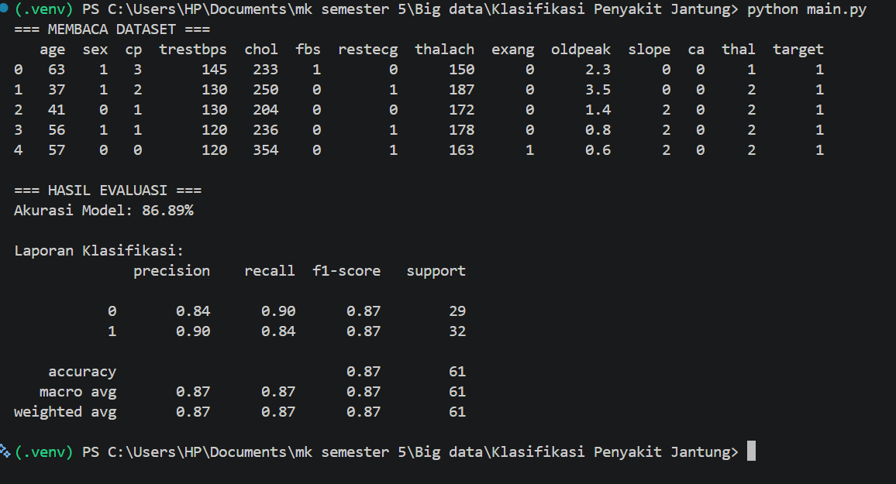
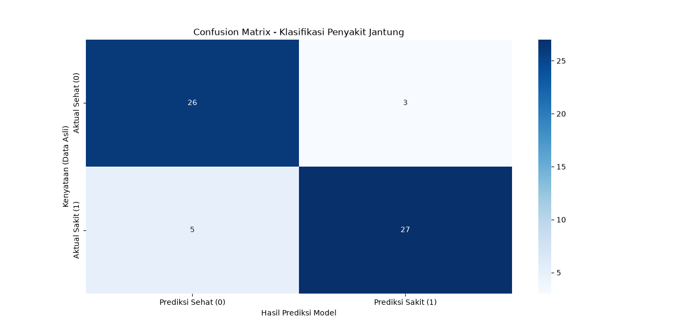
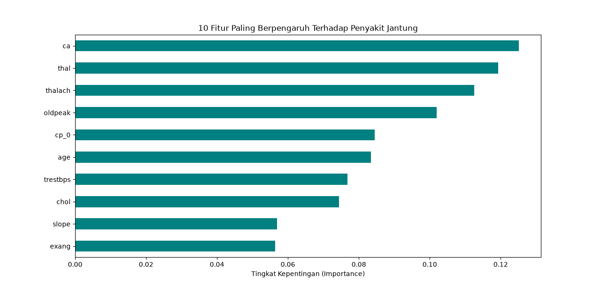

# Klasifikasi Penyakit Jantung (Heart Disease)
Tugas Mata Kuliah Big Data - Implementasi Algoritma Random Forest.

**Akurasi Model:** 86.89%

## Hasil Visualisasi

### 1. Output Terminal (Akurasi & Classification Report)

### 2. Confusion Matrix

### 3. Feature Importance (Fitur Paling Berpengaruh)

